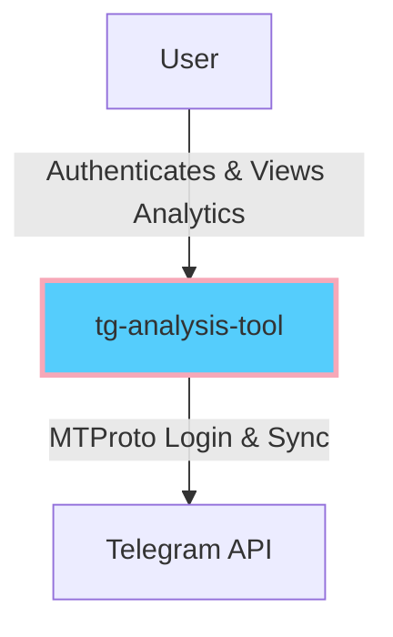
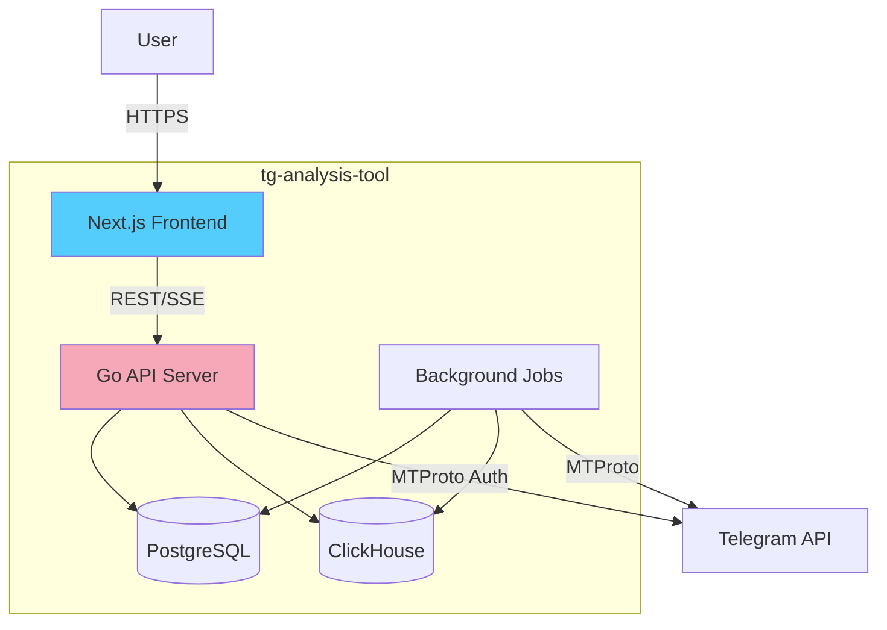
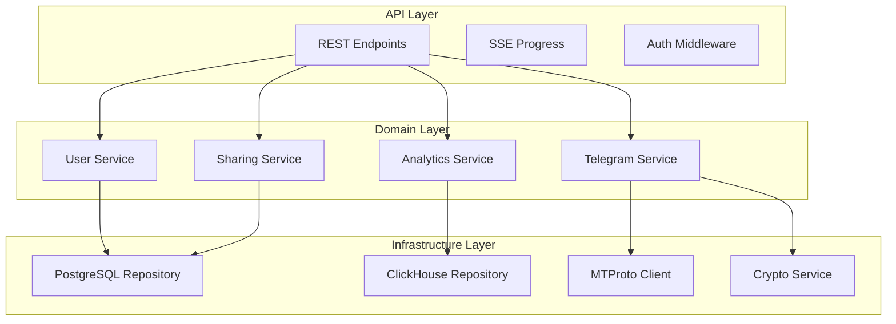
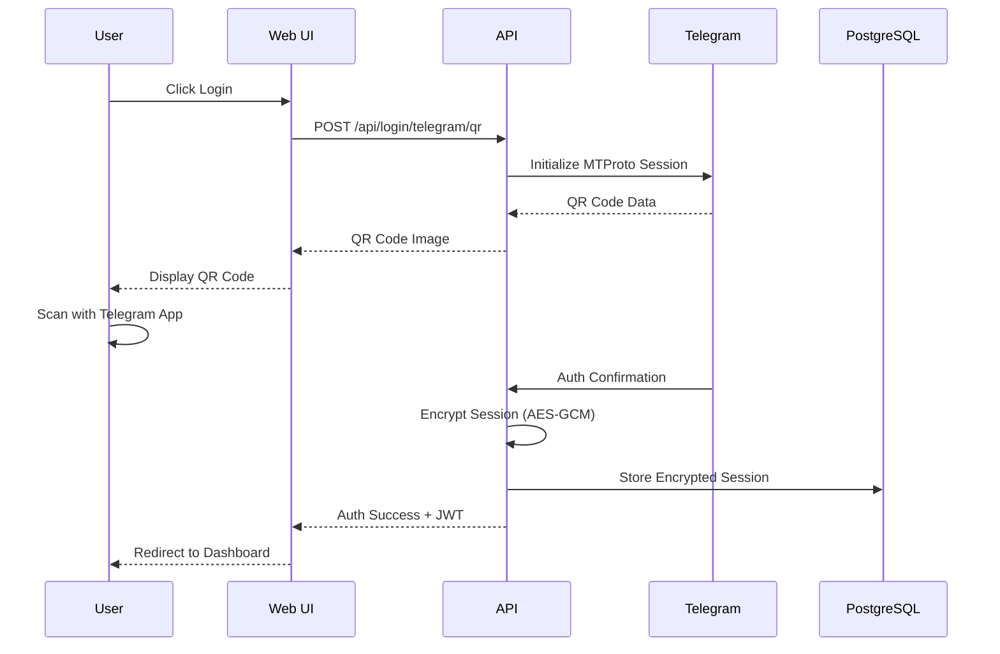
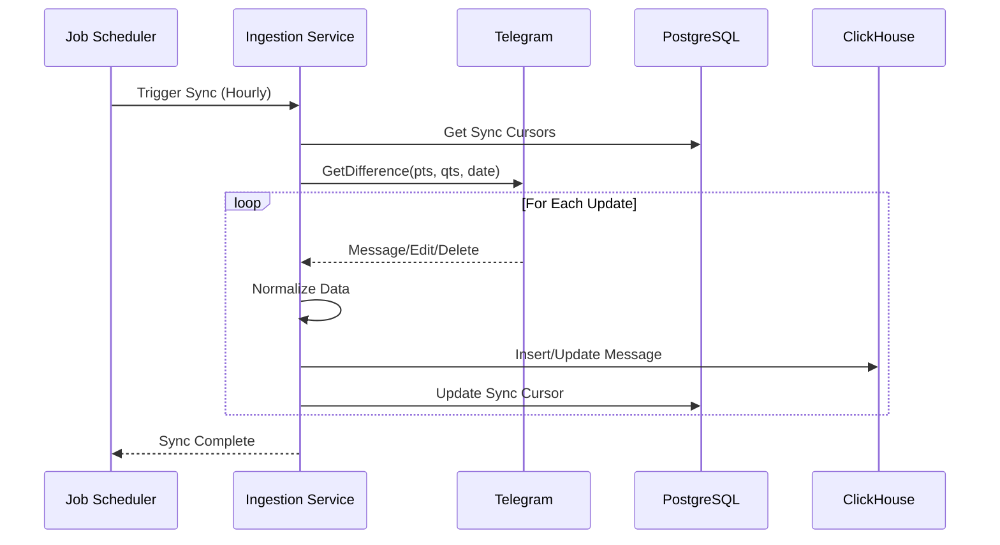
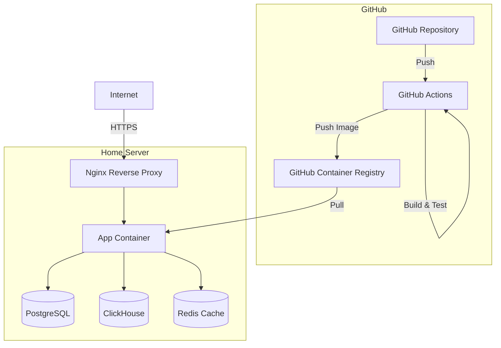

# tg-analysis-tool System Design

## Overview

tg-analysis-tool is a multi-tenant web application that ingests Telegram chats via MTProto API and provides fast, interactive analytics. The system prioritizes correctness, speed, and maintainability while remaining cloud-agnostic.

## Architecture Overview

### C4 Context Diagram



### C4 Container Diagram



### Component Architecture (Backend)



## Data Flow

### Authentication Flow



### Data Ingestion Flow



## Database Design

### PostgreSQL Schema (Multi-tenant Core)

```sql
-- Users and Organizations
CREATE TABLE users (
    id UUID PRIMARY KEY DEFAULT gen_random_uuid(),
    email VARCHAR(255) UNIQUE NOT NULL,
    created_at TIMESTAMPTZ NOT NULL DEFAULT NOW(),
    updated_at TIMESTAMPTZ NOT NULL DEFAULT NOW()
);

CREATE TABLE orgs (
    id UUID PRIMARY KEY DEFAULT gen_random_uuid(),
    name VARCHAR(255) NOT NULL,
    slug VARCHAR(255) UNIQUE NOT NULL,
    created_at TIMESTAMPTZ NOT NULL DEFAULT NOW()
);

CREATE TABLE org_members (
    user_id UUID REFERENCES users(id),
    org_id UUID REFERENCES orgs(id),
    role VARCHAR(50) NOT NULL DEFAULT 'member',
    created_at TIMESTAMPTZ NOT NULL DEFAULT NOW(),
    PRIMARY KEY (user_id, org_id)
);

-- Telegram Integration
CREATE TABLE telegram_accounts (
    id UUID PRIMARY KEY DEFAULT gen_random_uuid(),
    user_id UUID REFERENCES users(id),
    org_id UUID REFERENCES orgs(id),
    phone VARCHAR(20) NOT NULL,
    session_blob_enc BYTEA NOT NULL,
    session_kek_version INT NOT NULL DEFAULT 1,
    created_at TIMESTAMPTZ NOT NULL DEFAULT NOW(),
    last_login_at TIMESTAMPTZ,
    UNIQUE(org_id, phone)
);

CREATE TABLE dialogs (
    id UUID PRIMARY KEY DEFAULT gen_random_uuid(),
    org_id UUID REFERENCES orgs(id),
    account_id UUID REFERENCES telegram_accounts(id),
    tg_peer_type VARCHAR(20) NOT NULL, -- 'user', 'chat', 'channel'
    tg_peer_id BIGINT NOT NULL,
    title VARCHAR(255),
    is_excluded BOOLEAN NOT NULL DEFAULT FALSE,
    created_at TIMESTAMPTZ NOT NULL DEFAULT NOW(),
    UNIQUE(org_id, account_id, tg_peer_type, tg_peer_id)
);

CREATE TABLE sync_cursors (
    id UUID PRIMARY KEY DEFAULT gen_random_uuid(),
    org_id UUID REFERENCES orgs(id),
    account_id UUID REFERENCES telegram_accounts(id),
    dialog_id UUID REFERENCES dialogs(id),
    pts INT,
    qts INT,
    max_date TIMESTAMPTZ,
    updated_at TIMESTAMPTZ NOT NULL DEFAULT NOW(),
    UNIQUE(account_id, dialog_id)
);

-- Sharing
CREATE TABLE shares (
    id UUID PRIMARY KEY DEFAULT gen_random_uuid(),
    org_id UUID REFERENCES orgs(id),
    resource_type VARCHAR(50) NOT NULL, -- 'dashboard', 'report'
    resource_id UUID NOT NULL,
    visibility VARCHAR(20) NOT NULL, -- 'private', 'org', 'public'
    token VARCHAR(255) UNIQUE,
    created_at TIMESTAMPTZ NOT NULL DEFAULT NOW(),
    expires_at TIMESTAMPTZ
);

-- Row Level Security
ALTER TABLE telegram_accounts ENABLE ROW LEVEL SECURITY;
ALTER TABLE dialogs ENABLE ROW LEVEL SECURITY;
ALTER TABLE sync_cursors ENABLE ROW LEVEL SECURITY;
ALTER TABLE shares ENABLE ROW LEVEL SECURITY;
```

### ClickHouse Schema (Analytics)

```sql
-- Main messages table
CREATE TABLE messages (
    tenant_id UUID,
    account_id UUID,
    chat_id UUID,
    message_id UInt64,
    date DateTime('Europe/Moscow'),
    from_id UInt64,
    to_thread_id Nullable(UInt64),
    type Enum8('text' = 1, 'sticker' = 2, 'photo' = 3, 'video' = 4, 'voice' = 5, 'file' = 6, 'service' = 7),
    text Nullable(String),
    sticker_emoji Nullable(String),
    has_media UInt8,
    media_bytes Nullable(UInt64),
    voice_secs Nullable(UInt16),
    video_secs Nullable(UInt16),
    reply_to Nullable(UInt64),
    entities Array(String),
    emojis Array(String),
    is_deleted UInt8 DEFAULT 0,
    updated_at DateTime DEFAULT now()
) ENGINE = MergeTree()
PARTITION BY toYYYYMM(date)
ORDER BY (tenant_id, chat_id, date, message_id)
SETTINGS index_granularity = 8192;

-- Tokenized words for text analysis
CREATE TABLE words (
    tenant_id UUID,
    message_id UInt64,
    word String,
    position UInt16,
    date Date
) ENGINE = MergeTree()
PARTITION BY toYYYYMM(date)
ORDER BY (tenant_id, word, date)
SETTINGS index_granularity = 8192;

-- Materialized Views for Performance
CREATE MATERIALIZED VIEW agg_daily_messages
ENGINE = SummingMergeTree()
PARTITION BY toYYYYMM(day)
ORDER BY (tenant_id, chat_id, type, day)
AS SELECT
    tenant_id,
    chat_id,
    type,
    toDate(date) as day,
    count() as message_count,
    sum(voice_secs) as total_voice_secs,
    sum(video_secs) as total_video_secs
FROM messages
WHERE is_deleted = 0
GROUP BY tenant_id, chat_id, type, day;

CREATE MATERIALIZED VIEW agg_hourly_heatmap
ENGINE = SummingMergeTree()
ORDER BY (tenant_id, weekday, hour)
AS SELECT
    tenant_id,
    toDayOfWeek(date) as weekday,
    toHour(date) as hour,
    count() as message_count
FROM messages
WHERE is_deleted = 0
GROUP BY tenant_id, weekday, hour;
```

## API Design

### Authentication Endpoints

```yaml
/api/login/telegram/qr:
  post:
    summary: Initialize QR code login
    responses:
      200:
        content:
          application/json:
            schema:
              type: object
              properties:
                qr_code: string
                session_id: string

/api/login/telegram/verify:
  post:
    summary: Verify phone code
    requestBody:
      content:
        application/json:
          schema:
            type: object
            properties:
              phone: string
              code: string
              session_id: string
```

### Analytics Endpoints

```yaml
/api/analytics/activity:
  get:
    summary: Get activity timeline
    parameters:
      - name: start_date
        in: query
        schema:
          type: string
          format: date
      - name: end_date
        in: query
        schema:
          type: string
          format: date
      - name: granularity
        in: query
        schema:
          type: string
          enum: [hour, day, week, month]
    responses:
      200:
        content:
          application/json:
            schema:
              type: object
              properties:
                series:
                  type: array
                  items:
                    type: object
                    properties:
                      timestamp: string
                      count: integer
```

## Security Considerations

### Session Encryption

```go
// Key derivation using HKDF
func deriveKey(masterKey []byte, info string) []byte {
    hkdf := hkdf.New(sha256.New, masterKey, nil, []byte(info))
    key := make([]byte, 32)
    hkdf.Read(key)
    return key
}

// Encrypt session with AES-GCM
func encryptSession(session []byte, key []byte) ([]byte, error) {
    block, err := aes.NewCipher(key)
    if err != nil {
        return nil, err
    }
    
    gcm, err := cipher.NewGCM(block)
    if err != nil {
        return nil, err
    }
    
    nonce := make([]byte, gcm.NonceSize())
    if _, err := io.ReadFull(rand.Reader, nonce); err != nil {
        return nil, err
    }
    
    return gcm.Seal(nonce, nonce, session, nil), nil
}
```

### Row-Level Security Policies

```sql
-- Ensure users can only access their org's data
CREATE POLICY tenant_isolation ON telegram_accounts
    FOR ALL
    USING (org_id IN (
        SELECT org_id FROM org_members 
        WHERE user_id = current_setting('app.current_user_id')::UUID
    ));
```

## Performance Optimization

### ClickHouse Query Optimization

1. **Partition Pruning**: Queries should always include date ranges
2. **Index Usage**: Primary key (tenant_id, chat_id, date) for efficient filtering
3. **Materialized Views**: Pre-aggregated data for common queries
4. **Sampling**: For large datasets, use SAMPLE clause for approximate results

### Caching Strategy

1. **Redis** for session data and hot queries
2. **HTTP Cache Headers** for public dashboards
3. **Query Result Cache** in ClickHouse for repeated analytics

## Deployment Architecture



## Monitoring & Observability

### Metrics Collection

- **Application Metrics**: Prometheus format at `/metrics`
- **Custom Metrics**:
  - `tg_messages_ingested_total`
  - `tg_sync_duration_seconds`
  - `tg_analytics_query_duration_seconds`

### Logging Strategy

```json
{
  "level": "info",
  "time": "2024-01-01T12:00:00Z",
  "service": "tg-analysis-tool",
  "component": "ingestion",
  "tenant_id": "uuid",
  "message": "Sync completed",
  "messages_processed": 1500,
  "duration_ms": 2340
}
```

## Scalability Considerations

1. **Horizontal Scaling**: Stateless API servers behind load balancer
2. **Database Sharding**: ClickHouse cluster for large deployments
3. **Queue-based Processing**: Consider adding RabbitMQ/Kafka for async jobs
4. **CDN**: Static assets and public dashboards

## Disaster Recovery

1. **Backup Strategy**:
   - PostgreSQL: Daily full + hourly incremental
   - ClickHouse: Daily snapshots
   - Encrypted backups to object storage

2. **Recovery Procedures**:
   - RPO: 1 hour
   - RTO: 4 hours
   - Documented runbook for restoration